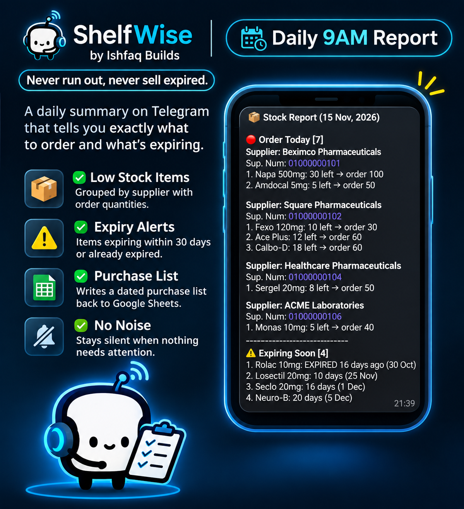
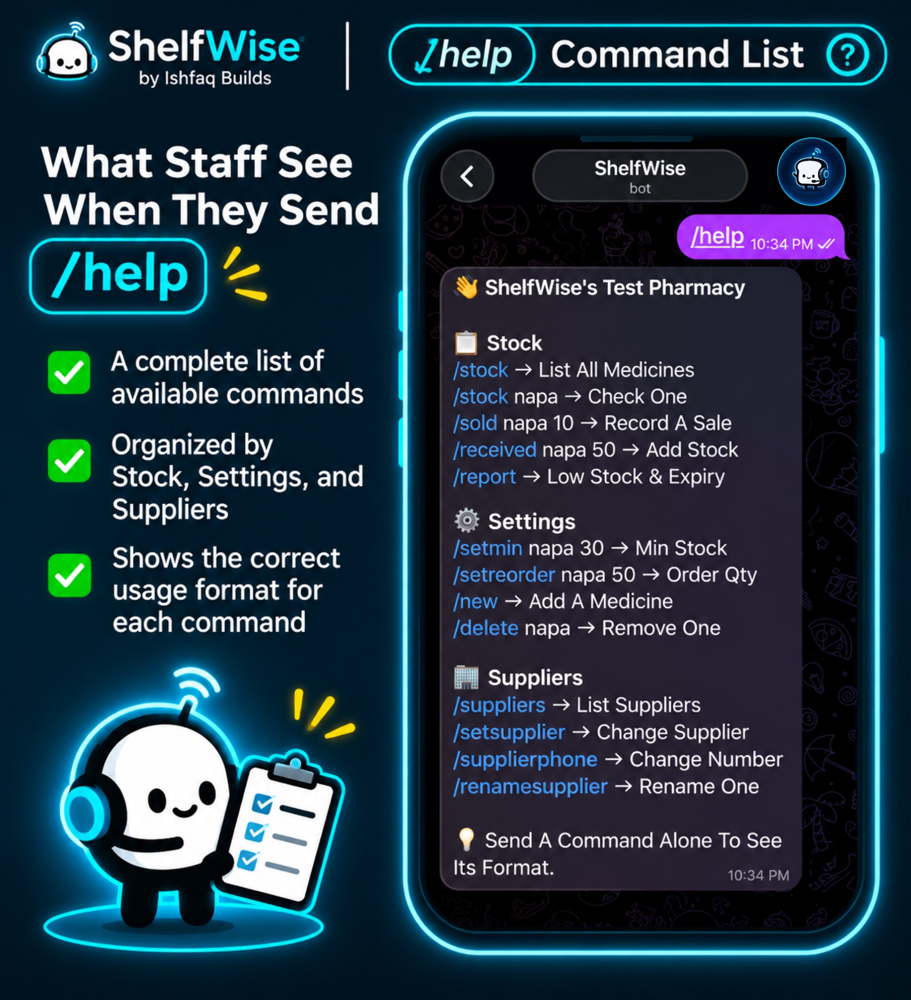
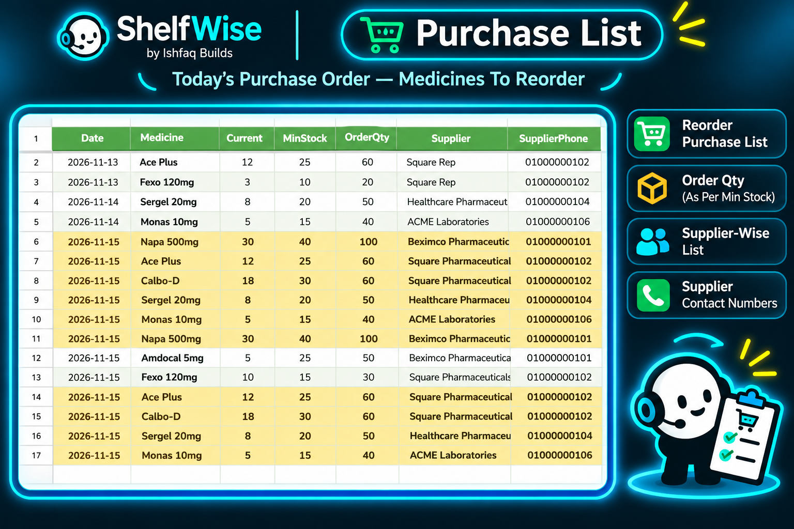

# ShelfWise: Pharmacy Stock Management Workflow (n8n)

**Never Run Out, Never Sell Expired.** Stock management for small pharmacies and shops using **n8n**, **Google Sheets** and **Telegram**. There's nothing to install for the shop: they use a Google Sheet and a Telegram chat.

## Features

**📦 Daily Stock Alerts** (One Workflow Per Pharmacy)

- Sends one Telegram message every morning at 9AM.
- Lists medicines at or below minimum stock, grouped by supplier, with the supplier's number and how many to order.
- Lists medicines expiring within 30 days, or already expired.
- Writes a dated purchase list back to Google Sheets.
- Stays silent when nothing needs attention.

**💬 Telegram Stock Bot** (One Workflow For All Pharmacies)

- Staff update stock by chat: `/sold napa 10, seclo 5` or `/received napa 50`.
- They can check stock, add or delete medicines, and set minimum and reorder amounts.
- They can manage suppliers and their phone numbers.
- Partial names work (`napa` finds `Napa 500mg`), and the bot asks when a name is ambiguous.
- Sending a command alone (`/new`, `/setsupplier`…) replies with its format and an example.
- Only registered users can edit. Each person is mapped to their pharmacy's sheet.

## How It Works

```
STOCK ALERTS (Per Pharmacy)
Every Morning 9AM → Read Stock Sheet → Analyze Stock & Build Report
                                          ├→ Send Telegram Alert
                                          └→ Split Purchase List → Save to Purchase List Sheet

TELEGRAM STOCK BOT (All Pharmacies)
Telegram Trigger → Read Clients → Route & Parse → Registered?
                                                    ├ true  → Read Stock → Process Command → Update / Add / Delete rows + Send Reply
                                                    └ false → Reply: Not Registered (shows the sender's chat ID)
```

## Screenshots

**Daily 9AM Report**: items to reorder, grouped by supplier with contact numbers and order quantities, plus expiry warnings.



**Updating Stock By Chat**: a sale recorded with `/sold`, with the new count and a low-stock flag.


**Command List**: what staff see when they send `/help`.



**Google Sheets As The Database**: the stock tab (left) and the dated purchase list the workflow writes (right).

| Stock | Purchase List |
|---|---|
|  |  |

**The n8n Workflows**


*All Screenshots Use Test Data.*

## Repository Structure

```
├── README.md
├── workflows/
│   ├── pharmacy-stock-alerts.json     # Import Into n8n (Daily Alerts)
│   └── pharmacy-stock-bot.json        # Import Into n8n (Telegram Stock Bot)
├── templates/
│   ├── stock-sheet-template.csv       # Pharmacy "Stock" Tab (Sample Data)
│   ├── purchase-list-template.csv     # Pharmacy "Purchase List" Tab (Headers)
│   └── clients-template.csv           # Your Admin "Clients" Sheet
├── code/                              # Code-Node Scripts, For Building By Hand
│   ├── alerts-analyze-stock.js
│   ├── alerts-split-purchase-list.js
│   ├── bot-route-and-parse.js
│   ├── bot-process-command.js
│   ├── bot-split-updates.js
│   ├── bot-split-new-items.js
│   └── bot-split-deletes.js
├── screenshots/                       # Images Used In This README
└── docs/
    ├── google-cloud-console.md        # Google Project, APIs, Service Account
    ├── pharmacy-stock-management.md   # Main Guide: Alerts, Sheets, Onboarding, Bot Management
    ├── telegram-stock-bot.md          # Stock Bot: Node-By-Node Build Guide And Commands
    └── multi-pharmacy-setup.md        # Running The System For Many Pharmacies
```

## Requirements

- n8n, self-hosted or Cloud (tested on n8n 2.x, self-hosted)
- A Google Cloud project with the **Google Sheets API** and **Google Drive API** enabled
- A Google **service account** with a JSON key
- A Telegram bot created with **@BotFather**

Everything except hosting is free.

## Quick Start

1. **Google:** follow [`docs/google-cloud-console.md`](docs/google-cloud-console.md).
2. **Telegram Bot And Alerts:** follow [`docs/pharmacy-stock-management.md`](docs/pharmacy-stock-management.md), section 3.
3. **Stock Bot:** follow [`docs/telegram-stock-bot.md`](docs/telegram-stock-bot.md).
4. **Each New Pharmacy:** follow the onboarding checklist in `pharmacy-stock-management.md`, section 5.
5. **More Than One Pharmacy:** read [`docs/multi-pharmacy-setup.md`](docs/multi-pharmacy-setup.md).

Each guide gives two options: **import** the ready workflow, or **build it by hand** node by node using the scripts in `code/`.

**Don't import `pharmacy-stock-bot.json` twice.** One Telegram bot can only feed one workflow. A second copy takes the bot over from the first.

**Source Of Truth:** the workflow JSON files. The `code/` scripts are copies of the Code nodes. If you change code in n8n, re-export the workflow and update the matching file in `code/`.

## Bot Commands

| Command | Action |
|---|---|
| `/stock napa` · `/stock` | Check One Medicine · List All |
| `/sold napa 10, seclo 5` | Record Sales |
| `/received napa 50` | Record A Delivery |
| `/setmin napa 30` · `/setreorder napa 50` | Set Minimum · Set Order Quantity (`0` = Auto) |
| `/new Name \| Qty \| Min \| Supplier \| Phone \| Expiry \| Reorder` | Add A Medicine |
| `/delete napa` → `/delete Napa 500mg YES` | Delete, With Confirmation |
| `/report` | Low Stock And Expiry Right Now |
| `/suppliers` · `/setsupplier` · `/supplierphone` · `/renamesupplier` | Manage Suppliers |

## Security

This repository contains **no credentials**. The workflows use placeholders: `PASTE_YOUR_GOOGLE_SHEET_ID_HERE`, `PASTE_OWNER_TELEGRAM_CHAT_ID` and `PASTE_CLIENTS_SHEET_ID`.

- Never commit your service account key, Telegram bot token or n8n encryption key.
- If a secret leaks, revoke the token with `/revoke` in BotFather, or delete the key in Google Cloud and create a new one.

## Roadmap

- [x] Daily Low-Stock And Expiry Alerts
- [x] Telegram Stock Management Bot
- [ ] Master Alert Workflow Driven By The Clients Sheet (One Workflow Instead Of One Per Pharmacy)
- [ ] Faster Input For Busy Counters: A Photo Of The Day's Ledger Page, Read By AI, Confirmed With One Tap
- [ ] Change Log (Who Changed What) And Staff Permissions (Block `/delete` For Staff)
- [ ] WhatsApp Alerts
- [ ] Sales History Log

---

Built by **Ishfaq Builds**.
