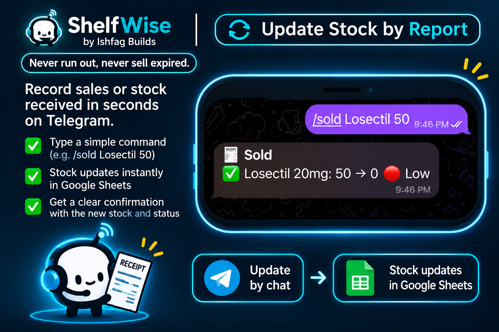
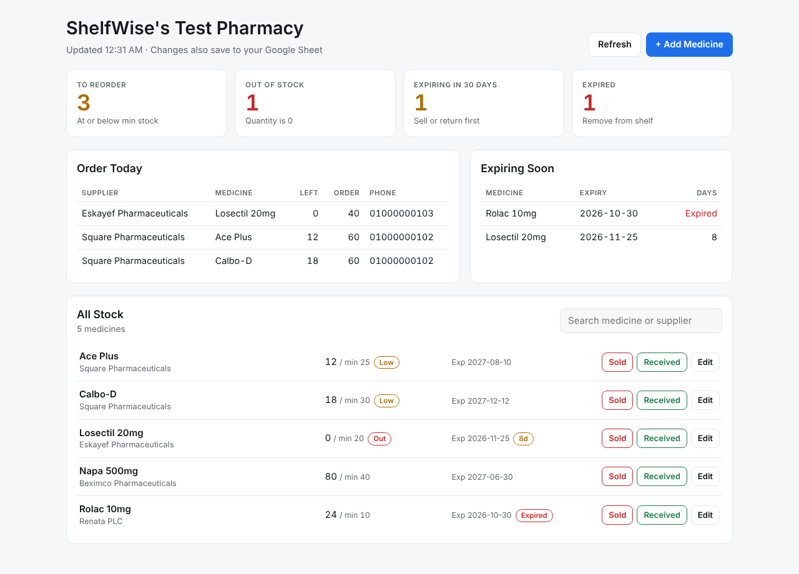

# ShelfWise: Pharmacy Stock Management (n8n)

**Never Run Out, Never Sell Expired.** Stock management for small pharmacies and shops using n8n, Google Sheets and Telegram. There's nothing to install for the shop: they get a Telegram bot, a web dashboard and their own Google Sheet.

## Features

**📦 Daily 9AM Alerts**
- Low stock, grouped by supplier, with order quantities
- Expiring and expired items
- One workflow for all shops, toggled per person from the `Alerts` column

**💬 Telegram Stock Bot**
- Update stock by chat: `/sold napa 10`, `/received napa 50`
- Manage medicines and suppliers
- `/dashboard` sends each person their private web dashboard link

**🖥️ Web Dashboard (Per Client)**
- One click Sold / Received, edit, add and delete
- Search, pages, no duplicate medicines
- Saves straight to the shop's Google Sheet. The sheet stays editable too

**🔐 Admin Panel (Private)**
- Password protected
- Clients grouped by pharmacy, with roles and users
- Payments: mark paid, auto adds next month, Telegram reminders before and after the due date

## How It Works

```
Telegram   → Bot Workflow   → Shop's Sheet
Web Link   → Web Workflow   → Shop's Sheet
9AM        → Daily Workflow → Stock Alerts + Payment Reminders
Admin Page → Admin Workflow → Clients + Payments
```

Every workflow looks people up in one **Admin sheet** (`Clients` + `Payments` tabs). Adding a shop is a new row, not a new workflow.

## Screenshots

### Telegram Bot

| Daily 9AM Report | Updating Stock By Chat | Command List |
|:---:|:---:|:---:|
|  |  |  |

<br>

### Web Dashboard



<br>

### Google Sheet


<br>

*Test Data Only.*

## Repository Structure

```
├── README.md
├── workflows/                         # Import Into n8n
│   ├── shelfwise-bot.json             # Telegram Stock Bot
│   ├── shelfwise-web.json             # Client Web Dashboards
│   ├── shelfwise-daily.json           # 9AM Stock Alerts + Payment Reminders
│   └── shelfwise-admin.json           # Admin Panel
├── templates/
│   ├── stock-sheet-template.csv       # Shop "Stock" Tab
│   ├── pharmacy-stock-template.xlsx
│   ├── clients-template.csv           # Admin "Clients" Tab
│   ├── payments-template.csv          # Admin "Payments" Tab
│   └── admin-clients-template.xlsx    # Both Admin Tabs
├── code/                              # Code Node Scripts (Same As In The Workflows)
├── screenshots/
└── docs/
    ├── google-cloud-console.md        # Google Project, APIs, Service Account
    ├── pharmacy-stock-management.md   # Main Guide: Setup, Onboarding, Payments
    └── telegram-stock-bot.md          # Bot: Nodes And Commands
```

## Requirements

- n8n (Self Hosted Or Cloud) on a public HTTPS domain
- Google Cloud Service Account (Sheets + Drive API)
- Telegram Bot From @BotFather

## Quick Start

1. **Google:** [`docs/google-cloud-console.md`](docs/google-cloud-console.md)
2. **Everything Else:** [`docs/pharmacy-stock-management.md`](docs/pharmacy-stock-management.md)
3. **Bot Details:** [`docs/telegram-stock-bot.md`](docs/telegram-stock-bot.md)

> Import each workflow **once**. One bot = one bot workflow.

## Bot Commands

| | Command | Action |
|:---:|---|---|
| 📋 | `/stock` | List All Medicines |
| 📋 | `/stock napa` | Check One |
| 📋 | `/sold napa 10` | Record A Sale |
| 📋 | `/received napa 50` | Add Stock |
| 📋 | `/report` | Low Stock & Expiry |
| 🖥️ | `/dashboard` | Web Dashboard Link |
| ⚙️ | `/setmin napa 30` | Min Stock |
| ⚙️ | `/setreorder napa 50` | Order Qty |
| ⚙️ | `/new` | Add A Medicine |
| ⚙️ | `/delete napa` | Remove One |
| 🏢 | `/suppliers` | List Suppliers |
| 🏢 | `/setsupplier` | Change Supplier |
| 🏢 | `/supplierphone` | Change Number |
| 🏢 | `/renamesupplier` | Rename One |

## Security

- No credentials in this repo. Never commit keys or tokens.
- Each dashboard link carries a random per person key. Clear the `Key` cell to revoke it.
- Set a 12+ character admin password before publishing the admin workflow. Never share the admin link.

## Roadmap

- [x] Daily Alerts
- [x] Telegram Stock Bot
- [x] One Alert Workflow For All Shops
- [x] Web Dashboard Per Client
- [x] Admin Panel With Payments
- [ ] Ledger Photo → AI → Stock Update
- [ ] Change Log & Staff Permissions
- [ ] WhatsApp Alerts

---

Built By **Ishfaq Builds**.
