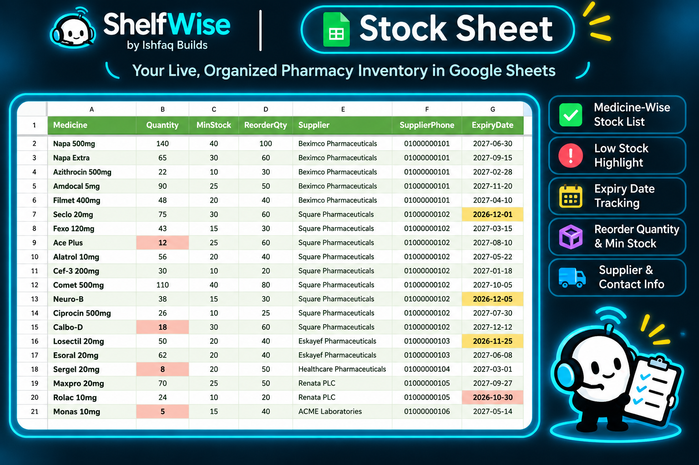
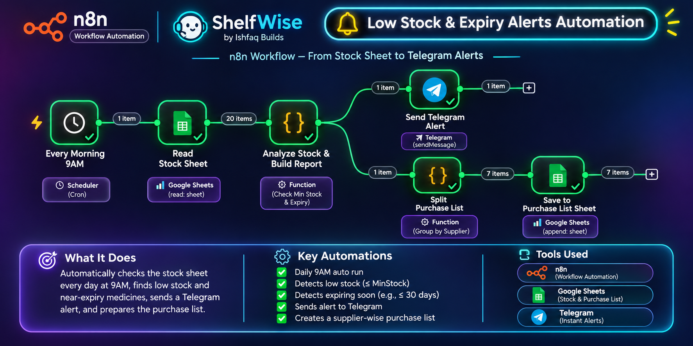
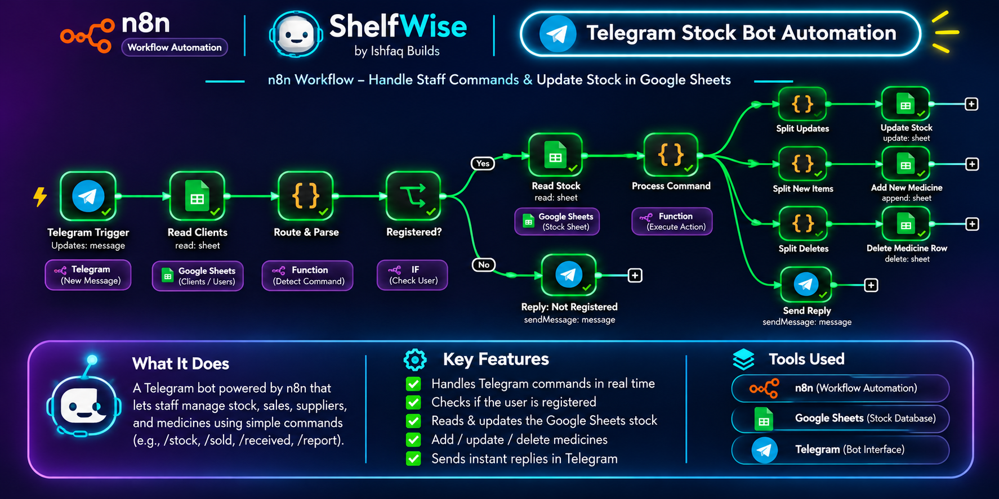

# ShelfWise: Pharmacy Stock Management (n8n)

**Never Run Out, Never Sell Expired.** Stock management for small pharmacies and shops using n8n, Google Sheets and Telegram. There's nothing to install for the shop: they use a Google Sheet and a Telegram chat.

## Features

**📦 Daily Stock Alerts**
- 9AM Telegram report
- Low stock, grouped by supplier, with order quantities
- Expiring and expired items
- Auto purchase list in Google Sheets

**💬 Telegram Stock Bot**
- Update stock by chat: `/sold napa 10`, `/received napa 50`
- Manage medicines and suppliers
- Partial name search
- One bot for all shops

## How It Works

**📦 Daily Alerts:** 9AM → Read Stock → Telegram Report + Purchase List

**💬 Stock Bot:** Command → Find Shop → Update Stock → Reply

## Screenshots

### Telegram Bot

| Daily 9AM Report | Updating Stock By Chat | Command List |
|:---:|:---:|:---:|
|  |  |  |

<br>

### Google Sheets

| Stock | Purchase List |
|:---:|:---:|
|  |  |

<br>

### n8n Workflows

| Daily Stock Alerts | Telegram Stock Bot |
|:---:|:---:|
|  |  |

<br>

## Repository Structure

```
├── README.md
├── workflows/
│   ├── pharmacy-stock-alerts.json     # Import Into n8n (Daily Alerts)
│   └── pharmacy-stock-bot.json        # Import Into n8n (Telegram Stock Bot)
├── templates/
│   ├── stock-sheet-template.csv       # Pharmacy "Stock" Tab (Sample Data)
│   ├── purchase-list-template.csv     # Pharmacy "Purchase List" Tab (Headers)
│   └── clients-template.csv           # Your Admin "Clients" Sheet
├── code/                              # Code-Node Scripts, For Building By Hand
│   ├── alerts-analyze-stock.js
│   ├── alerts-split-purchase-list.js
│   ├── bot-route-and-parse.js
│   ├── bot-process-command.js
│   ├── bot-split-updates.js
│   ├── bot-split-new-items.js
│   └── bot-split-deletes.js
├── screenshots/                       # Images Used In This README
└── docs/
    ├── google-cloud-console.md        # Google Project, APIs, Service Account
    ├── pharmacy-stock-management.md   # Main Guide: Alerts, Sheets, Onboarding, Bot Management
    ├── telegram-stock-bot.md          # Stock Bot: Node-By-Node Build Guide And Commands
    └── multi-pharmacy-setup.md        # Running The System For Many Pharmacies
```


## Requirements

- n8n (Self-Hosted Or Cloud)
- Google Cloud Service Account (Sheets + Drive API)
- Telegram Bot From @BotFather

## Quick Start

1. **Google:** [`docs/google-cloud-console.md`](docs/google-cloud-console.md)
2. **Alerts:** [`docs/pharmacy-stock-management.md`](docs/pharmacy-stock-management.md)
3. **Bot:** [`docs/telegram-stock-bot.md`](docs/telegram-stock-bot.md)
4. **Multiple Shops:** [`docs/multi-pharmacy-setup.md`](docs/multi-pharmacy-setup.md)

> Import the bot workflow **once**. One bot = one workflow.

## Bot Commands

| | Command | Action |
|:---:|---|---|
| 📋 | `/stock` | List All Medicines |
| 📋 | `/stock napa` | Check One |
| 📋 | `/sold napa 10` | Record A Sale |
| 📋 | `/received napa 50` | Add Stock |
| 📋 | `/report` | Low Stock & Expiry |
| ⚙️ | `/setmin napa 30` | Min Stock |
| ⚙️ | `/setreorder napa 50` | Order Qty |
| ⚙️ | `/new` | Add A Medicine |
| ⚙️ | `/delete napa` | Remove One |
| 🏢 | `/suppliers` | List Suppliers |
| 🏢 | `/setsupplier` | Change Supplier |
| 🏢 | `/supplierphone` | Change Number |
| 🏢 | `/renamesupplier` | Rename One |

## Security

No credentials in this repo. Never commit keys or tokens.

## Roadmap

- [x] Daily Alerts
- [x] Telegram Stock Bot
- [ ] One Alert Workflow For All Shops
- [ ] Ledger Photo → AI → Stock Update
- [ ] Change Log & Staff Permissions
- [ ] WhatsApp Alerts

---

Built By **Ishfaq Builds**.
